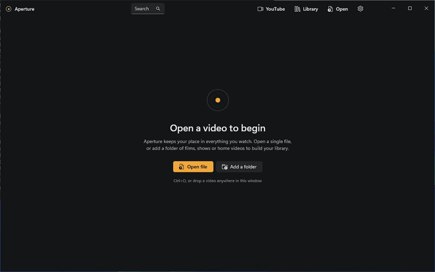
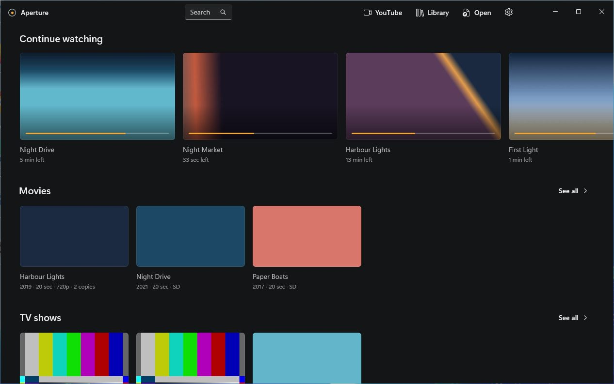
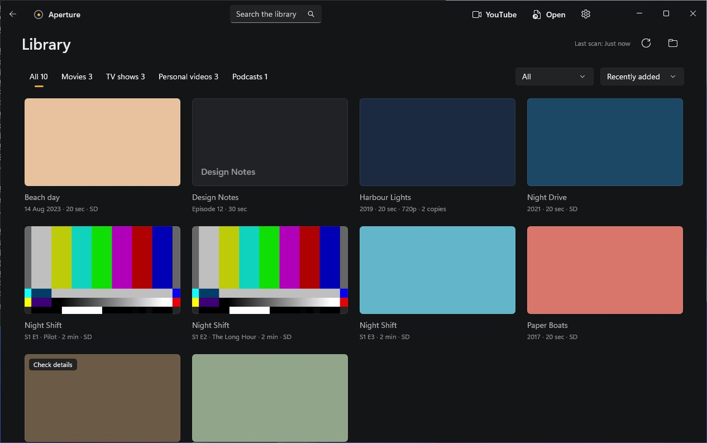
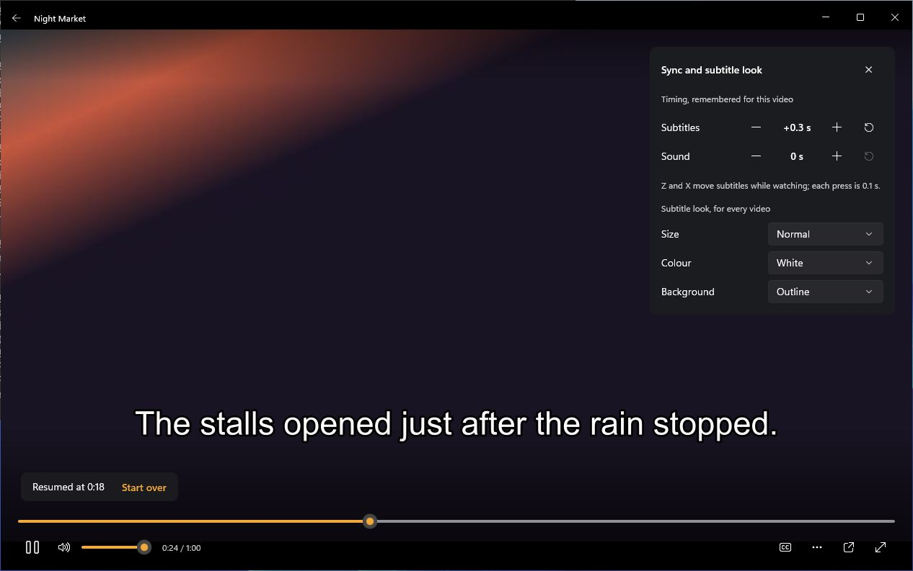
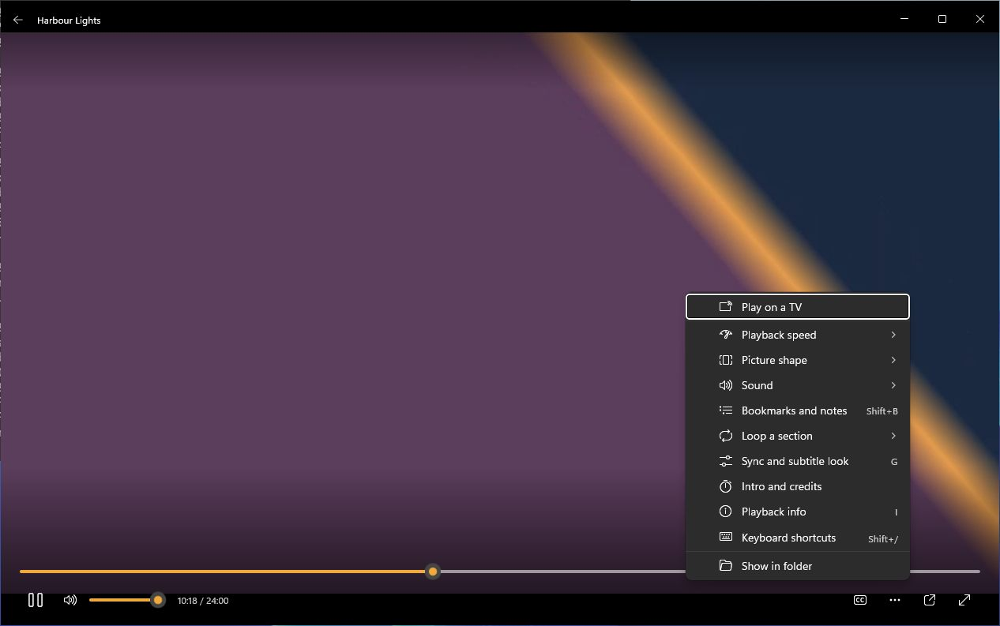
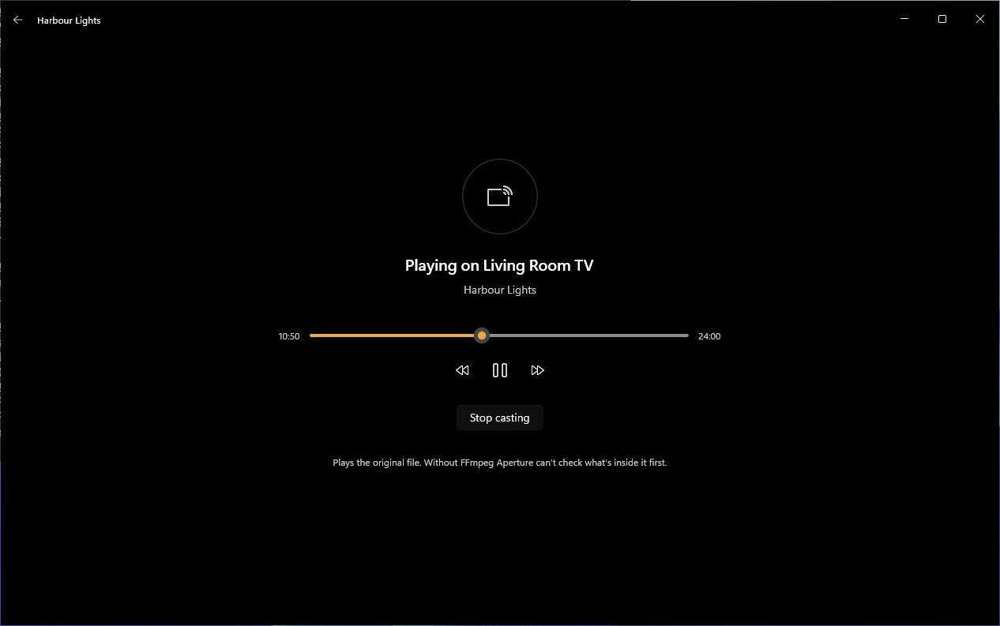
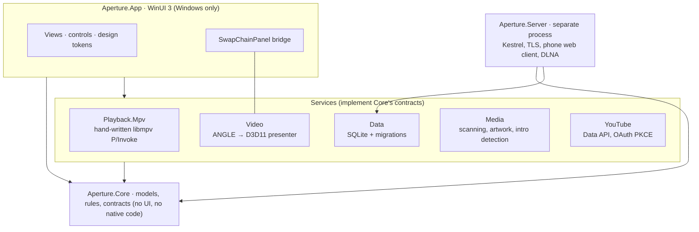

<div align="center">


# Aperture

**A calm, native video player for Windows 11, built on libmpv and WinUI 3.**

[](https://github.com/KhanAdeeb1/Aperture-Video-Player/actions/workflows/ci.yml)
[](https://github.com/KhanAdeeb1/Aperture-Video-Player/releases)
[](LICENSE)


[Download](https://github.com/KhanAdeeb1/Aperture-Video-Player/releases/latest) · [Features](docs/features.md) · [Architecture](docs/architecture.md) · [Design system](docs/design-system.md)



</div>

Aperture plays local video through an embedded libmpv engine, keeps a personal library of films, shows, home videos and podcasts without ever touching your files, finds intros and credits by comparing episodes, streams your library to phones on your home network, and plays on DLNA TVs. The video is always the focus: controls appear when you need them and get out of the way when you don't.

> **Status: 0.1.0, an early release.** Every screenshot here comes from the real app, driven and captured automatically on GitHub's Windows runners with generated test clips. Those machines have no GPU, sound device or second monitor, so hardware decoding, HDR displays, multi-monitor setups and high-DPI scaling are still being tested on real PCs. See [tested configurations](docs/tested-configurations.md).

## Highlights

- **libmpv inside WinUI 3.** libmpv renders through ANGLE into a Direct3D 11 swap chain hosted by a XAML `SwapChainPanel`, so the controls are ordinary, accessible XAML drawn over the video with no second window. [How it works ↓](#how-libmpv-is-embedded)
- **A player that stays out of the way.** Auto-hiding controls, seek previews, subtitle and audio sync, bookmarks with notes, A–B loop, clearer dialogue, a mini player, and every shortcut remappable.
- **A library that respects your files.** Background scanning, films and shows sorted from file names, duplicate copies grouped, optional TMDB details with your own key. Media files are only ever read.
- **Episodes that flow.** Intro, recap and credits detection by comparing episodes' sound and picture, with Skip buttons and a next-episode countdown.
- **Beyond the PC.** An optional media server (a separate process, with TLS from its own certificate authority and passphrase sign-in) streams to phones and tablets in the browser, and Aperture can cast to DLNA TVs as a remote.
- **YouTube, done properly.** Plays in YouTube's own embedded player through the official Data API. No stream extraction or scraping.

## Screenshots

| | |
|---|---|
|  |  |
| **Home.** Continue watching with time left, then the library by kind. | **Library.** One grid, kinds as tabs, scanned in the background. |
|  |  |
| **Sync and subtitle look.** Offsets remembered per video. | **More menu.** Advanced features one click away, not on the bar. |
|  |  |
| **Casting.** Aperture becomes the remote for a DLNA TV. | **Phone.** The media server's web client on a phone. |

## Install

1. Download `Aperture-0.1.0-x64-setup.exe` (or `ARM64` for Snapdragon PCs) from the [latest release](https://github.com/KhanAdeeb1/Aperture-Video-Player/releases/latest). A portable zip is there too.
2. Run it. No administrator rights are needed. The installer isn't code-signed yet, so SmartScreen asks you to choose **More info › Run anyway**.
3. Open a video with Ctrl+O, by dropping it on the window, or from Explorer's **Open with** menu.

Upgrading keeps your library and settings; uninstalling asks before removing them. Details: [Installing, upgrading and removing](docs/install.md).

## Architecture



Dependencies point inward: every service depends only on `Aperture.Core`, which depends on nothing. Core, Data, Media, Server and the engine's non-rendering parts target plain `net10.0`, so their tests also run on Linux. Full detail: [docs/architecture.md](docs/architecture.md).

### How libmpv is embedded

libmpv's render API only speaks OpenGL (or software), while WinUI 3 composes with Direct3D. Aperture bridges the two without a second window:

```
libmpv render API (OpenGL ES 3)        draws into an EGL pbuffer
ANGLE (EGL + GLES on Direct3D 11)      pbuffer wraps a D3D11 texture on Aperture's own device
DXGI composition swap chain            one GPU copy per frame
XAML SwapChainPanel                    controls are plain XAML above it
```

- The frame never leaves the GPU, and there's no dependency on vendor GL/DX interop extensions.
- The same path runs on WARP, so CI renders real frames and checks their pixels. If ANGLE can't start, a software renderer takes over.
- libmpv events run on a dedicated thread and are marshalled to the UI; commands are asynchronous, so the UI thread never waits on mpv. Disposal order is fixed and tested, because shutting down a native engine mid-event is where players usually hang.

## Design decisions

| Decision | Why | Trade-off accepted |
|---|---|---|
| **libmpv** over LibVLC or `MediaPlayerElement` | FFmpeg-wide format support, libass subtitles, high-quality scaling; doesn't depend on Store codec packs | Needs a GL→D3D bridge; GPL build shapes the licence |
| **ANGLE + `SwapChainPanel`** over mpv's own child window | Controls stay real XAML with focus, Mica and UI Automation; nothing to keep in sync on Snap, DPI or full screen | HDR is tone-mapped to SDR; one extra GPU copy per frame |
| **Hand-written P/Invoke** (`[LibraryImport]`) over a wrapper package | Small surface, full control of threading and lifetime, no unmaintained dependency | More code to own |
| **SQLite with versioned migrations** | One local file for settings, history, library and bookmarks; upgrades keep data | Not a sync service |
| **Media server as a separate process** | The player can't be taken down by the network side, and the server only runs when asked | Two executables to ship |
| **Design tokens before screens** | One accent ("Lamp", `#F2A93B`) for progress, primary action and selection; charcoal surfaces; Segoe UI Variable. Every screen answered a [design review](docs/design-system.md#2-design-review) before it was built | Fewer screens, each finished |
| **No faked success** | Engine tests play real files on Linux and Windows; tests that need a missing native library report *skipped*, never *passed* | Slower CI |

## Built and verified in CI

Every push runs [CI](.github/workflows/ci.yml) on Ubuntu and Windows:

- 400+ unit and integration tests across Core, Data, Media, Server, YouTube and the libmpv engine, which plays a matrix of real files (H.264, HEVC 10-bit, VP9, AV1, ProRes and more).
- WinUI builds for x64 and ARM64, plus a launch smoke test.
- **Visual review:** a UI Automation driver opens the real app at 1920×1080, walks through about 80 states and captures each one, with on-screen pixel checks.
- Installer tests: install, upgrade over an older version, uninstall, then open/close and playback soak tests.

Tagging a release also runs a two-hour 1080p60 playback soak before it drafts the GitHub release.

## Build from source

Windows 11 with the .NET 10 SDK:

```powershell
dotnet test tests/Aperture.Core.Tests/Aperture.Core.Tests.csproj
dotnet run --project src/Aperture.App/Aperture.App.csproj -p:Platform=x64
```

The pinned libmpv build is fetched and hash-checked during the build. On Linux or macOS only the platform-neutral projects build. See [Build and test](docs/build-and-test.md).

<details>
<summary>Repository layout</summary>

```
src/Aperture.App           WinUI 3 shell (Windows only)
src/Aperture.Core          platform-neutral models, rules and contracts
src/Aperture.Data          SQLite settings, playback history and the library
src/Aperture.Playback.Mpv  libmpv engine (P/Invoke, events, tracks, diagnostics)
src/Aperture.Video         Direct3D 11 video presenter (ANGLE and software paths)
src/Aperture.Media         library scanning, optional online details, artwork cache
src/Aperture.YouTube       YouTube Data API, oEmbed, Google sign-in
src/Aperture.Server        media server (separate process) and the phone web client
tests/                     unit and integration tests
tools/visual-review        test-clip generator and the screenshot driver used by CI
tools/packaging            install/upgrade/uninstall and soak tests
installer/                 Inno Setup script
third_party/               pins for native binaries (binaries aren't committed)
docs/                      design system, architecture, plan, milestone reports
```

</details>

## Documents

- [What Aperture does](docs/features.md) and [release notes](docs/release-notes.md)
- [Architecture](docs/architecture.md) and [design system](docs/design-system.md)
- [Watching on your phone](docs/media-server.md), [playing on a TV](docs/casting.md), [YouTube in Aperture](docs/youtube.md)
- [Security review of the media server and casting](docs/security-review.md)
- [Tested configurations](docs/tested-configurations.md), [dependencies and licences](docs/dependencies.md)
- [Milestone reports](docs/reports/): how the project was planned and built, one milestone at a time

## Licence

Aperture is free software under the [GNU General Public License, version 3 or later](LICENSE). It includes GPL builds of libmpv and FFmpeg and other components listed in [THIRD-PARTY-NOTICES.md](THIRD-PARTY-NOTICES.md).
