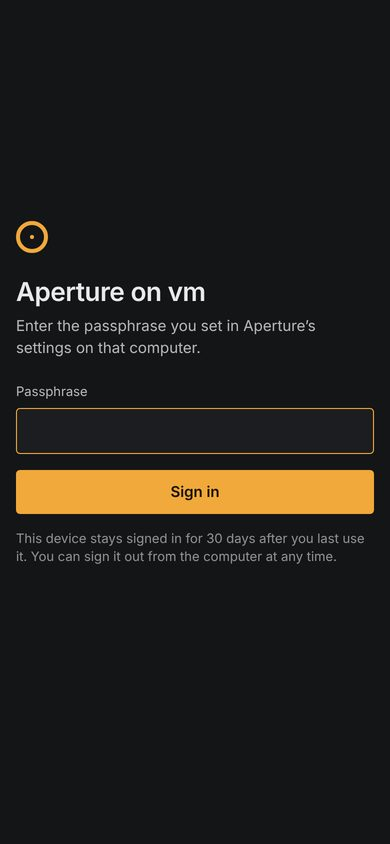
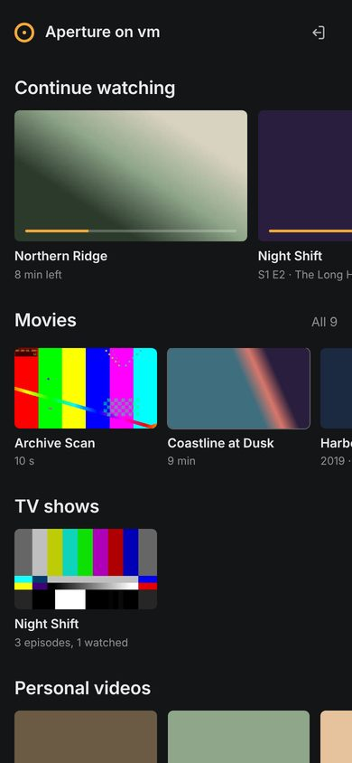
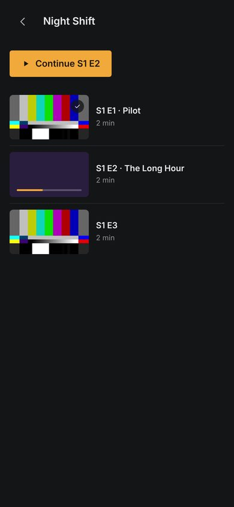
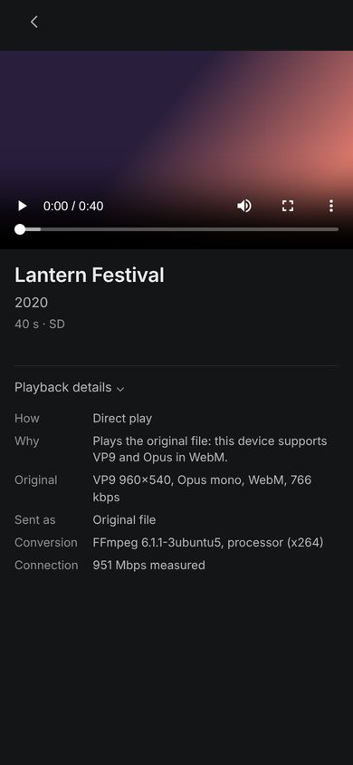
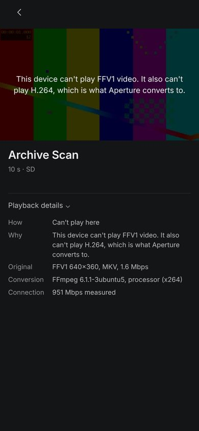
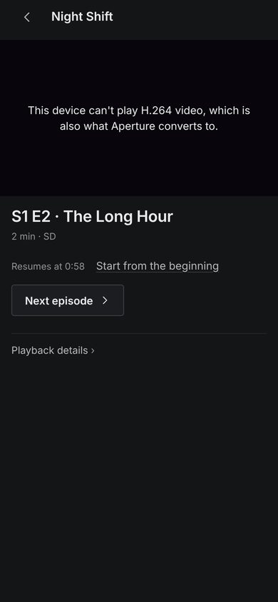

# Milestone 7 report: media server and phones

Date: 2026-10-15

**What's needed from you: one check on a real phone.** Everything here was tested by automated tests (the real server over HTTPS, real FFmpeg conversions) and in a browser on Linux, but not yet on an iPhone or Android phone, and the browser available here can't play H.264, so a converted stream has been checked with FFprobe, not watched. The setup is in [docs/media-server.md](../media-server.md): in Aperture, Settings › Media server, share a folder, set a passphrase, press Start, then open the address it shows on your phone. For conversions, install FFmpeg (`winget install Gyan.FFmpeg`). No packages were added.

## 1. Implemented

- **A separate media server.** `Aperture.Server.exe` is its own program, published next to the app in `Server\`. Aperture starts it hidden, asks it for its status and asks it to stop; it never hosts it. Closing Aperture leaves it running. It can also be run and controlled from the command line (`status`, `stop`, `set-passphrase`, `share`, `devices`, `sign-out`, `ports`), and optionally started when you sign in to Windows (one entry under your user's Run key, added only when you turn the setting on).
- **Settings › Media server** in the desktop app: Start/Stop with a live one-line status (on, how many devices are playing, keeping the computer awake, or why it can't start); the address to open on a phone with Copy address and the certificate fingerprint; passphrase; a switch per library folder (nothing shared by default); signed-in devices with when and from where each was last used, Sign out and Sign out all; Keep the computer awake while a device plays; Allow devices on a private network (off by default); Start when I sign in; Converting for devices (which converter is in use, Choose ffmpeg.exe…, conversions at once); Ports.
- **Only folders you chose, never arbitrary paths.** Devices name items by number. An item is served only if its folder is shared, its path lies inside that folder with no `.` or `..` parts, and the last scan found it. There is no file browsing, and no path is ever sent to a device.
- **Authentication and authorisation on every request.** A passphrase you set (stored as a salted PBKDF2 hash, checked in constant time, with lockouts after 5 wrong tries) signs a device in for 30 days from its last use. The device holds a random token in an `HttpOnly`, `Secure`, `SameSite=Strict` cookie; only its hash is stored. Media addresses carry a per-device, per-item token, and every media request checks again that the device is still signed in and the item still shared. Changing the passphrase signs everyone out.
- **Encrypted connections.** HTTPS with Aperture's own certificate authority, limited by name constraints to private addresses and local names, kept in your user's certificate store. A plain-HTTP setup page shows how to install the certificate on iPhone and Android and the fingerprint to compare. Strict browser security headers; a custom header required on changing requests.
- **Home network and private networks only.** Connections from public addresses are refused before anything else runs, whatever the settings. Remote access is through a private network you set up (Tailscale or WireGuard), only after turning on Allow devices on a private network. Nothing is opened to the internet, and Aperture changes no firewall or router settings.
- **A web client for phones and tablets** in the browser: sign in; Continue watching; Movies, TV shows, Personal videos and Podcasts; a show page with seasons and episodes; a player with the browser's own controls, Resume at / Start from the beginning, Next episode, and Playback details. Add it to the home screen to open it like an app. Same tokens as the desktop (charcoal, the Lamp accent only, 16:9 artwork).
- **Direct play first, conversion only when needed.** For each playback the phone reports what it can play and its measured connection. The server sends the original file (with seeking) when the phone can play it and the connection can carry it; repackages H.264 into a stream without re-encoding when only the container or sound is the problem; and converts to H.264/AAC at 1080p, 720p, 480p or 360p (never upscaled) only when the video can't be played or the connection is too slow. Hardware encoders are found by a real test encode (NVIDIA, Intel, AMD), otherwise the processor. HLS for phones; one continuous MP4 for browsers without HLS. Conversions are written to Aperture's data folder and deleted after use; originals are only read.
- **Playback diagnostics.** Playback details on the phone shows how the file is sent and why, the original's codecs, size and bitrate, the stream, the converter and its speed, and the measured connection.
- **Positions sync both ways, safely.** The phone saves its position every 10 seconds, on pause and when you leave; the server clamps it to the library's own length and writes the same history the desktop uses (and respects the desktop's Remember played videos setting). The phone resumes from where you left off on the PC and vice versa.
- **Laptops.** While a device is playing, the server asks Windows not to sleep from idle, and lets go a minute after playback stops (a setting, on by default). Closing the lid or pressing the power button still sleeps; Aperture changes no power settings. The certificate is renewed when the network changes. The guide covers sleep, lid, battery, networks, VPNs and hardware encoding.

## 2. Files changed

- **Core** (`src/Aperture.Core/Server/`): `NetworkAccess`, `Passphrase` and `DeviceToken`, `SharedMedia` and `RemoteProgress`, `StreamPlanner` (with `SourceMedia`, `ClientCapabilities`, `StreamPlan`), `ServerSettings`, `RemoteDevice`, `IServerStore`, `ServerControl` (`ServerStateFile`, `ServerStatus`, `ServerControlClient`). `Storage/AppDataLocation` gains `At(path)`.
- **Data**: migration `0005_server.sql` (`server_shared_folders`, `server_devices`), `SqliteServerStore`, `SqliteLibraryStore.FindByIdAsync`.
- **New project `src/Aperture.Server`**: `Program` (command line), `Hosting/` (`MediaServer`, `ServerContext`, `ApiEndpoints`, `MediaEndpoints`, `SetupEndpoints`, `PlaybackActivity` and `KeepAwake`, `ServerPaths`, `FileLogger`), `Security/` (`CertificateAuthority`, `ServerCertificates`, `LoginThrottle`, `DeviceAuth`), `Library/SharedLibrary`, `Media/` (`FfmpegTools`, `ConversionManager`, `Thumbnails`), and the web client in `wwwroot/` (`index.html`, `app.css`, `app.js`, icons, manifest).
- **App**: `Services/MediaServerHost.cs` (start, stop, status, sign-in entry), `Services/AppServices.cs`, `App.xaml.cs` (`--media-server` start at sign-in), `Views/SettingsView.xaml` (Media server group), new `Views/SettingsView.MediaServer.cs`, `MainWindow.xaml.cs` (FFmpeg file picker), `Aperture.App.csproj` (publishes the server into `Server\`).
- **Tests**: Core `Server/` (`NetworkAccessTests`, `PassphraseTests`, `SharedMediaTests`, `StreamPlannerTests`, `ServerSettingsTests`); Data `SqliteServerStoreTests` and the schema test; new `tests/Aperture.Server.Tests` (`SecurityTests`, `LibraryAndPlaybackTests`, `ConversionTests`, `ControlAndCertificateTests`, `TestServer`).
- **CI and tools**: `ci.yml` installs FFmpeg for the test jobs, runs the server tests, checks the bundled server starts and stops, and shows the server log in the visual review; `Capture-States.ps1` has a Media server step. `Aperture.sln` includes both new projects.
- **Docs**: new `docs/media-server.md`; architecture §1, §2 and new §12, dependencies, design system (review rows and components), build and test, README, this report and its screenshots in `docs/reports/milestone-7/`.

## 3. Verification

Run locally on Linux (.NET 10, FFmpeg 6.1 installed):

| Suite | Result |
|---|---|
| Core | 357 passed, 0 failed (80 new) |
| Data | 43 passed, 0 failed (8 new) |
| Server (new) | 38 passed, 0 skipped, 0 failed |
| Media | 56 passed, 0 failed |
| YouTube | 35 passed, 0 failed |

The server tests start the real server on loopback with its own data folder and talk to it over HTTPS, trusting only its own authority:

- **Authentication enforced**: every library, item, image, play, progress and speed-test request is 401 without a sign-in; a wrong passphrase sets no cookie; the cookie is `Secure`, `HttpOnly`, `SameSite=Strict`; a forged token, a signed-out device and a changed passphrase all lose access; no passphrase means nobody can sign in; changing requests without the custom header are 403; 5 wrong passphrases lock the address out, even for the right one, until the lock ends.
- **Unauthorised paths and files can't be reached**: items in unshared folders are 404 for details, play and progress; library responses contain no paths; made-up media tokens, `..` and `%2e%2e` in any position, made-up conversion segments, negative and unknown ids all give 404 or 400; unsharing a folder or signing a device out stops a media address that was already handed out.
- **Network rules**: a public address is refused for the app, the API, media, sign-in and the setup page; a Tailscale address only after the setting is turned on; control requests answer this computer only and need the token; the setup port serves no library or media.
- **Direct play**: a range request returns exactly the requested bytes (206), the whole file matches, and the original is unchanged.
- **Repackaging and conversion with real FFmpeg**: an H.264 MKV becomes an HLS playlist with valid MPEG-TS segments, with the original file unchanged and nothing new written beside it; an MPEG-4/MP3 AVI becomes a continuous MP4 starting with `ftyp`; FFmpeg's arguments are separate values with the input as `file:` + path (a path containing `; rm -rf ~ $(whoami)` stays one argument).
- **Positions sync**: a reported position lands in the desktop's history with the library's length, shows as the resume point, and nonsense (negative) is refused; nothing is saved when history is off on the desktop.
- **Certificates**: the authority carries name constraints; the server certificate names private and Tailscale addresses but never a public one; TLS chains to the authority; a client trusting only public authorities refuses the connection.
- **Server control**: status and stop through the control address; the server shuts down by itself.

By hand on Linux, with the server built from this branch: started in the background, `status`, `stop` and started again from the published self-contained build; a second copy refused to start; curl with the authority's certificate confirmed TLS and OpenSSL's enforcement of the name constraints. In headless Chromium at phone size (390×844): signed in, browsed, opened a show, played a VP9/Opus WebM directly (its time advanced) and the position was saved to history (23.9 s of 40 s); files Chromium can't play showed why. Chromium as shipped with Playwright has no H.264, AAC or HLS, which is why HLS and the continuous MP4 were checked with FFprobe and the tests above rather than watched in a browser.

The app's C# was compile-checked on Linux against the Windows App SDK reference assemblies, with every XAML event handler checked. On Windows, CI builds x64 and ARM64 with the server bundled, runs every suite (FFmpeg installed, so the conversion tests run there too), checks the bundled server starts and stops, and runs the visual review; results are on the PR.

## 4. Visual review

Design review answers for the new states are in [design-system.md](../design-system.md) §2. In short: in Settings, Start is the one accent button and the status line beside it is the most important text; the connect address and devices appear only when there is something to show; there is no dashboard. On the phone, the video uses the browser's own controls, which are better on each phone and accessible; the rest is the desktop's card language.

Phone screenshots (Chromium at 390×844, from this branch):

| | | |
|---|---|---|
|  |  |  |
| Sign in | Home with Continue watching | A show with seasons and progress |
|  |  |  |
| Direct play with Playback details | A file this browser can't play, saying why | An episode: resume line, Start from the beginning, Next episode |

Tablet width: [tablet-09-home.jpg](milestone-7/tablet-09-home.jpg).

The visual-review job's new Media server step drives the real Windows app: Settings › Media server before starting (`90-settings-media-server`), sharing the test library and setting the passphrase through the interface, Start, signing in over HTTPS as a phone would and listing the library, the device appearing in Settings (`91-settings-media-server-running`), closing Aperture and checking the server still answers, then Stop, Start and Stop again from Settings. Its outcome is recorded on the PR.

## 5. Known limitations

- **Not yet tried on a real iPhone or Android phone.** The certificate install steps follow Apple's and Google's current menus; names vary between Android phones.
- **Converted streams were checked by tools, not watched**, because the browser available here has no H.264. Your phone is the first to watch one.
- **FFmpeg is not included.** Without it, files the phone can play still play; others say they need FFmpeg. With it, conversion speed depends on the hardware encoder found.
- **Repackaging from a point part-way through** starts at the nearest keyframe, so a few seconds early; an MKV without an index starts at the beginning.
- **The continuous MP4** (browsers without HLS, such as Firefox) can't seek past what has arrived; seeking further starts a new stream from there.
- **No subtitles on the phone yet, and only the first sound track.**
- **A public IPv6 address is refused even at home**, because it can't be told apart from the internet. Phones use the IPv4 address the setup page shows.
- **Progress made on a phone** reaches Aperture's Continue watching the next time Home refreshes.
- **Size.** The server is published self-contained (about 100 MB), separately from the app's own runtime. Sharing one runtime or trimming is for the release milestone.
- **Whether a phone enforces the certificate's name constraints** was not tested; OpenSSL does.

## 6. Regression check

- All earlier suites pass unchanged: Core, Data, Media and YouTube; the libmpv engine tests run in CI. The player, the video presenter, the library scanner and YouTube were not changed.
- The desktop app works the same with the server off or absent: Settings shows "This copy of Aperture doesn't include the media server" if the `Server` folder is missing, and nothing else depends on it.
- Migration 5 only adds two tables; the Milestone 1 backup rule applies. The app's settings and the server's `server.*` settings are stored side by side without touching each other (tested).
- Library folders removed in Aperture are unshared automatically (foreign key, tested).
- The server reads the library the desktop scanned and writes only playback history (the same records the desktop writes), conversions and thumbnails in its own folder, and its log.
- The earlier visual review steps run unchanged before the Media server step.

## 7. Next step

Try it on your phone with the guide, and tell me what you see, especially the certificate step and a file that needs converting. Milestone 8 (Smart TV) is queued next.
